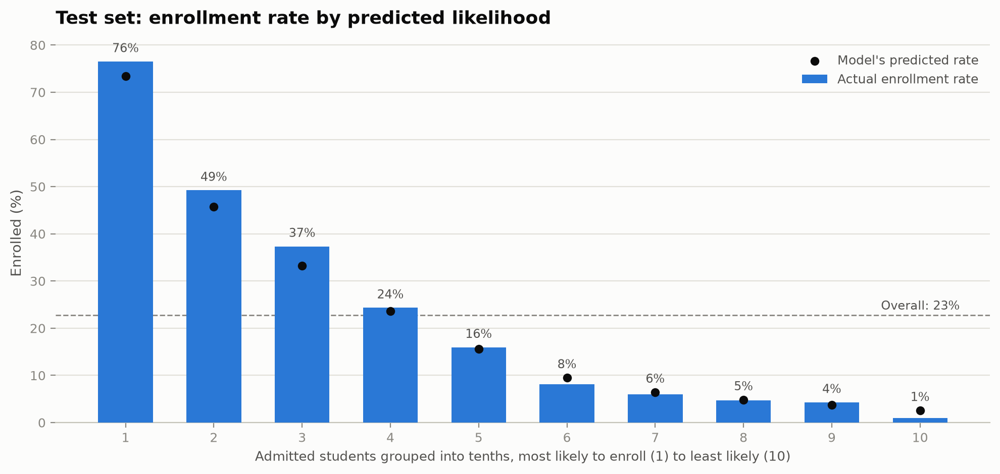
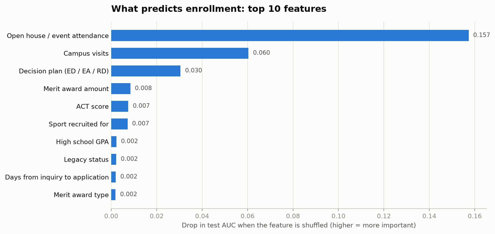

# Predicting Which Admitted Students Will Enroll

A yield model for Trinity University: given what the admissions office knows about an admitted first-year student, how likely are they to enroll? The data covers about 15,000 admitted students across five entering classes (Fall 2017 to Fall 2021).

This is a rebuild of my first major analytics project. The [original notebook](notebooks/v1_original.ipynb) is kept as v1. Version 2 fixes problems I found when I revisited it and adds an honest evaluation.

## Results

On 5,143 held-out admitted students, 22.7% of whom enrolled:

- **Ranking:** test AUC of **0.85**. The 10% of admits the model rated most likely to enroll actually enrolled at **76%**, against 23% overall. That top 20% accounted for **55% of all enrollees**.
- **Yes/no predictions:** Cohen's kappa of **0.49**, with 81.8% accuracy. For comparison, predicting "won't enroll" for everyone is 77.3% accurate but scores a kappa of 0.
- **Class size:** the model's predicted probabilities added up to **1,125 expected enrollees**, against 1,170 who actually enrolled, an underestimate of 3.8%.



The black dots show the model's predicted rate for each tenth of admits, and the bars show what actually happened. They track closely, so the probabilities can be used as real estimates, not just a ranking.

## What changed from v1

| Version | Test kappa | What it reflects |
|---|---|---|
| v1 as submitted (random forest) | 0.466 | Settings chosen on the test set; includes a leaked variable; mismatched category codes |
| v2 with the leaked variable left in | 0.536 | Shows how much the leak inflates results |
| **v2 final (gradient boosting)** | **0.487** | Honest estimate; settings chosen by cross-validation on training data only |
| v2 without sex, ethnicity, race, religion | 0.495 | Same accuracy without demographics (recommended) |

The final v2 kappa is higher than v1's even after removing a leak that was inflating v1. The v2 pipeline makes these fixes:

1. **Found a leaked variable.** The Legacy and Athlete fields contain an "Opt Out" tag. Of the 750 training admits with it, only 1 enrolled. The data dictionary doesn't define it, and a near-zero enrollment rate suggests it is recorded after a student declines. Leaving it in raises kappa from 0.487 to 0.536, but a model couldn't use it for students who haven't decided yet. v1's Legacy and Athlete categories included this tag.
2. **Consistent category codes.** v1 label-encoded the training and test sets separately, so the same category could get a different number in each set. All 23 majors kept in the training data ended up with different codes in the test data (Biology was one number in training and another in test). v2 learns one encoding from the training data and applies it to both.
3. **No tuning on the test set.** v1 chose its tree settings by test-set score, which makes that score optimistic. v2 tunes with 5-fold cross-validation inside the training data and scores the test set once.
4. **Test data cleaned with training-set values.** v1 filled missing values in the test set (such as ACT scores) using test-set averages, and grouped rare categories using test-set counts. v2 learns every fill-in value and grouping from training data only.
5. **Merit awards parsed correctly.** Award codes are a letter for the award type plus the amount in thousands (T23 is a $23,000 Trustee's award). The lookup table only listed 31 codes, so **71% of admits fell through to "None"** in v1. v2 parses every code into a type and dollar amount. The gain was small (test AUC +0.003), since academic measures already captured much of the same information.
6. **Probability cutoff chosen deliberately.** With a 23% enrollment rate, a 50% cutoff is rarely the best one. v2 picks the cutoff (35%) that maximized kappa in training cross-validation.
7. **Smaller fixes:** a religion grouping that was never saved back to the data, two merit codes assigned to two groups at once (sending a full-ride scholarship to "Domestic"), and Texas geomarkets merged into one region even though two-thirds of admits are from Texas.

## What drives enrollment



- **Engagement is the strongest signal by far.** Among training-set admits, 12.5% of those who attended no events enrolled, compared with 43% for one event and 75% for three or more. Campus visits show the same pattern.
- **Early Decision is binding,** so 94% of ED admits enrolled. Everyone else enrolled at 16 to 20%.
- **Bigger merit awards came with lower yield.** Murchison award recipients (the largest tiered award) enrolled at 17%, compared with 29% for Dean's award recipients. The strongest students likely have the most competing offers, so this shouldn't be read as awards discouraging enrollment.
- **Demographics add nothing measurable.** Removing sex, ethnicity, race, and religion changed test AUC by less than 0.001, so I'd recommend the model without them. It's just as accurate and avoids using protected characteristics to make decisions about students.

## Limitations

- **Event timing is unknown.** Some events, like scholarship days for admitted students, happen after admission, when a student may already be leaning one way. A model used early in the cycle would need event dates to separate pre-admission from post-admission engagement.
- **The train/test split is random across years.** In practice the model would forecast a future class, so a stricter test would train on 2017 to 2020 and predict 2021. 2021 was also the first test-optional year.
- **No financial aid amounts.** The data includes whether a student intended to apply for aid, not what they were offered, and need-based aid is typically one of the biggest drivers of yield.

## Data and privacy

The real data is confidential student-level records provided for a Trinity course, so it is **not in this repository**. The included [synthetic dataset](data/synthetic/tu_synthetic.csv) has the same 69 columns, so the code runs for anyone. Its columns are sampled independently in groups, with postal codes, staff names, and dates generated and enrollment simulated from a made-up formula. No synthetic row matches a real applicant, and results on it will not match the numbers above. Everything in `outputs/` is aggregated across hundreds of students or more.

## How to run

Python 3.10 or later.

```bash
pip install -r requirements.txt
python src/train.py        # tune and compare models, score the test set (about 7 minutes)
python src/make_charts.py
```

Without the real data, the scripts use the synthetic file and write to `outputs/synthetic_run/`. With access to the real data, put `TU.csv` in `data/raw/`, which is excluded from git, and results go to `outputs/`.

## Repository structure

```
data/
  raw/          real TU.csv goes here locally (never committed)
  reference/    merit award code table, state-to-region lookup
  synthetic/    tu_synthetic.csv, a stand-in with no real records
notebooks/
  v1_original.ipynb   the original course project (outputs removed)
src/
  config.py           paths and settings
  prepare.py          cleaning and feature engineering, learned from training data only
  train.py            model tuning, comparison, ablations, and test evaluation
  make_charts.py      README charts
  make_synthetic.py   how the synthetic file was generated
outputs/        aggregate results and charts from the real data
```

The v1 notebook needs pandas 2.x. On pandas 3, its in-place `fillna` calls stop changing the data.

---

Luke | Business Analytics & Marketing, Trinity University
